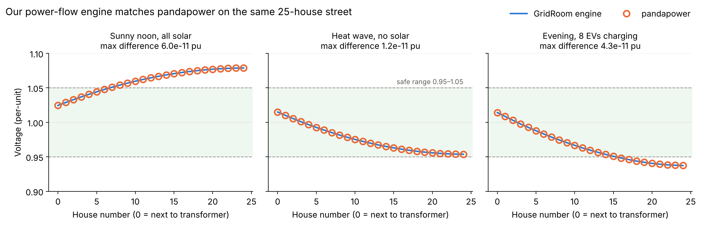

# GridRoom

**Why can't every house go solar? Run the grid, then check a real street.**

GridRoom is a web app about rooftop solar and the limits of neighborhood power lines. When many homes on a street export solar at noon, voltage at the far end rises. Past 1.05 per-unit, utilities can't connect more solar. That limit is called *hosting capacity*, and New Jersey's Board of Public Utilities is working on it right now.

Built by [@atharva-000](https://github.com/atharva-000) and [@Atharv-Gupta311](https://github.com/Atharv-Gupta311) for the 2026 Congressional App Challenge (NJ-12).

## What's in it

- **The game:** five levels on a 25-house sample street covering solar, a heat wave, EV charging, and smart inverters. Every house is colored by its voltage.
- **My Street:** enter an address, and GridRoom maps the real houses on that street from OpenStreetMap. It uses the utility's public solar map (PSE&G color or JCP&L number) to estimate how full the circuit is, then shows modeled voltage at every house and how many homes could add solar.
- **The engine:** a backward/forward-sweep power-flow solver with IEEE 1547 volt/VAR smart-inverter control, written in TypeScript.

## Run it

```
npm install
npm run dev      # local dev server
npm test         # engine, street model, and level tests
npm run build    # production build
```

## How the engine works

1. **Power flow.** The street is one radial line from a fixed 1.02 pu source. Each pass sums currents from the far end back (backward sweep), then subtracts each segment's voltage drop from the source outward (forward sweep), and repeats until voltages change by less than 1e-9.
2. **Smart inverters.** Each solar inverter sets reactive power from the IEEE 1547-2018 Category B volt/VAR curve. Inverters move 30% of the way to their target each round; without that damping the voltages oscillate.
3. **Hosting capacity.** Solar is added one home at a time (nearest-first for the best case, farthest-first for the worst case) until any house goes above 1.05 pu.
4. **My Street.** The utility map's remaining capacity (`roomKw`) becomes an upstream impedance `r = x = 3 / roomKw` pu, sized so that adding `roomKw` at the street entrance raises voltage from 1.02 to 1.05.

## Validation

We checked the solver against [pandapower](https://www.pandapower.org/) on the same 25-house street (`validation/validate.py`). The largest difference across three cases was about 6×10⁻¹¹ pu.

```
pip install -r validation/requirements.txt
python validation/validate.py --refresh
```



## Project layout

```
src/engine/   power flow, volt/VAR, hosting capacity
src/geo/      street model for My Street (geometry, OSM stitching, analysis)
src/levels/   level definitions
src/ui/       screens and components
scripts/      sample-street builder, validation export
validation/   pandapower check (Python) and chart
```

## Limitations

- The street's wires, transformer and loads are representative values. Utilities don't publish real circuit data.
- The utility map's room is shared by the whole circuit, not just one street.
- My Street models sunny spring noon only, and checks voltage limits only.
- GridRoom is a learning tool, not a utility measurement or advice about buying solar. It is not affiliated with PSE&G, JCP&L, or the NJ BPU.

## Credits

Map data © [OpenStreetMap](https://www.openstreetmap.org/copyright) contributors, via Nominatim and the Overpass API. Hosting-capacity context from the NJ Board of Public Utilities and the PSE&G and JCP&L public solar maps.
